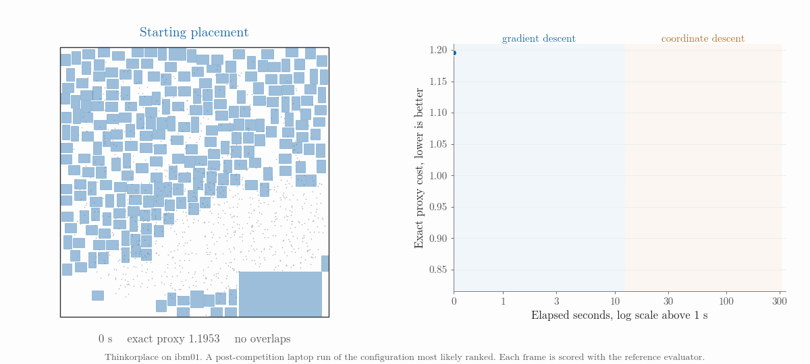
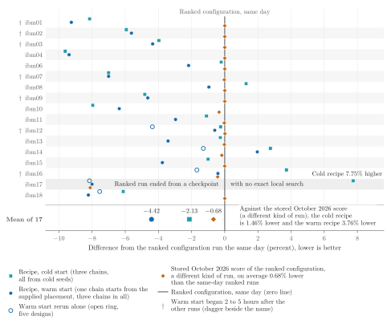
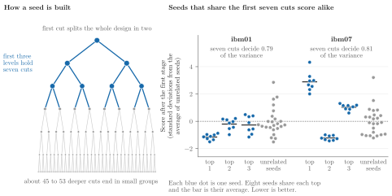
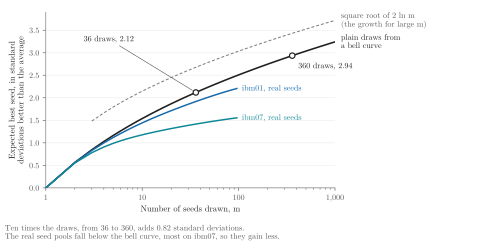
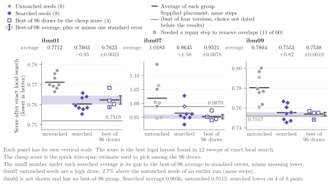
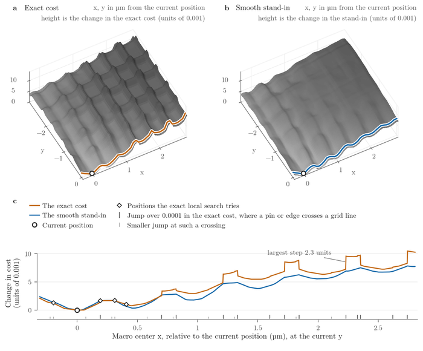

[Technical report (PDF)](thinkorplace-technical-report.pdf) ·
[Source code](https://github.com/brmurrell3/macro-placer) ·
[Placement explorer](placement-comparison.html)

Macro placement decides where to place large components on a chip before its
wires are routed. Each of these blocks, called a macro, is a pre-designed
circuit. Macros that have wires connecting them should sit nearby so the wires
stay short. However, macros that are too close leave no room to route those
wires. Additionally, macros may not overlap.

Thinkorplace is the placer I designed and implemented for the Partcl/Hudson
River Trading Macro Placement Challenge 2026. It finished ninth on the final
leaderboard (of 132 verified eligible submissions) with a verified mean proxy of
0.9974. My score is a 31.6% improvement over the published RePlAce baseline.
Runtime was 12 minutes per test case (max 60 minutes per test case).

<!-- The chart is drawn for a white background, so it keeps a white card in dark mode; the link opens it full size for small screens. -->

## How entries were scored

Entries were ranked on 17 IBM benchmark designs using the proxy cost defined by
Google’s Circuit Training combining wirelength, density, and congestion.
Wirelength estimates how much wire is needed to connect each net. Density
measures how crowded the layout is, averaging the most crowded 10% of grid
cells. Congestion compares routing demand with the available routing tracks and
averages the worst 5% of cells. Density and congestion each carry half the
weight of wirelength. Lower scores are better.

The reference evaluator takes between 1.4 and 27 seconds to score a placement.
That allows roughly 130 to 2,600 full evaluations per design in an hour, which
makes it impractical to test individual moves this way.

## How Thinkorplace works

### v1

My first version combined two starting methods, three types of local search, and
a curvature stage. When local search stalled, the curvature stage nudged the
placement along a direction where the smooth model curved downward, then ran
local search again. It took 3,192 seconds per design.

### v2

v2 is the ranked entry. It is a two stage process. First, it finds a quick
approximation of a good overall layout. Then it refines that layout through
small moves evaluated with the exact score.

The first stage uses gradient descent on a smooth approximation of the score,
allowing all the blocks to move together. A legalizer then resolves macro
overlaps by moving overlapping macros into nearby free space, starting with the
largest.

Because the approximation differs from the actual score, the second stage
optimizes the actual score directly. It uses coordinate descent, moving one
block along one axis at a time and accepting a move only if the exact score
improves. Each block stays within the free gap around it, so accepted moves
preserve a legal placement.

An incremental scorer makes this practical. Moving one block affects only a few
nets and grid cells, so the scorer updates those instead of recalculating the
entire placement. On sampled moves, this took 1.3 to 3.7 milliseconds, compared
with 1.4 to 27 seconds for the reference evaluator. The scores agreed within
floating-point rounding. That makes it possible to try about 100,000 moves in
ten minutes instead of a few hundred.

### v3

v3 came after the competition and keeps both stages. What changes is where it
starts. It draws many starting layouts, called seeds, by repeatedly splitting
the design's blocks into balanced halves. It ranks them with a cheap score and
sends only the best through the two stages.

v3 runs three chains side by side, one per core. One starts from the placement
the benchmark supplies, a warm start, and two start from drawn seeds, cold
starts. It keeps the best placement any chain finds in the 12 minutes.

## Results

v2 beat v1 in my May development runs. It took 524 seconds instead of 3,192 and
scored 7.1% lower on average, improving 16 of the 17 designs. Lower congestion
accounted for 84.5% of the gain.

v2 finished ninth with a verified mean proxy of 0.9974. Rerun on my laptop’s CPU
after the competition, it reached 0.98121 with valid placements for all 17
designs.

v3 scored about 4% lower than v2. Both ran on my laptop with 12 minutes and
three cores per design, and v3 averaged about 0.94 against about 0.99. It was
lower on 16 of the 17 designs and about 2% higher on ibm14. A version with all
three chains cold was about 2% lower than v2.

v3 also held up on four designs from a second benchmark family, NG45, that
nothing was tuned on. It was lower on all four and about 4% lower on average.

All of these results are proxy scores, not measurements from a full
place-and-route flow. I also developed the method on the same 17 public designs
used for the ranking.

## The math behind it

### Why the starting layout matters

A layout of ibm01 is one point in a space with two coordinates for each of its
1,140 blocks. Most of that space is illegal, because macros may not overlap. To
see what lies between good answers, I mixed three finished layouts block by
block over a flat grid. Of 841 mixes, only the three answers themselves were
legal.

The good answers sit apart on tiny islands. Moving any answer about a hundred
thousandth of the way toward another already makes macros overlap. Even with
overlaps ignored, the score climbs by more than half between them. Local search
that stays legal cannot walk from one island to another, so the seed decides
which island a run ends on. Within an island, exact search converges fast. If
G_m is the drop in score after
m sweeps of coordinate descent, it follows


G_m = G_\infty (1 - \rho^m)


where \rho, the share of the remaining gain left after
each sweep, is about a half to three quarters. Most of the gain comes in the
first few sweeps, and the rest of the run cannot leave the island.

A cold seed takes 50 to 60 cuts. Keeping a seed’s first seven cuts and redrawing
the rest showed that those seven decide about four fifths of how it scores after
the first stage.

Drawing more seeds and keeping the best pays, but slowly. For scores spread like
a bell curve with mean \mu and spread
\sigma, the expected best of m
draws grows like


\mathbb{E}\left[\min_{k \le m} X_k\right] \approx \mu - \sigma\sqrt{2 \ln m}


Ten times as many draws, from 36 to 360, buys less than one standard deviation,
and real seeds gain even less.

### Picking seeds with a cheap score

Since drawing more seeds pays slowly, v3 screens them instead. The span score
adds up how far wires stretch across the die, counting horizontal stretch about
1.6 times as much as vertical on the IBM designs. It works because congestion
averages the fullest 5% of routing loads, so it can never fall below the average
load, and the span score is a lower bound on the wire part of that average.


\text{congestion} \;\ge\; \text{mean load} \;\gtrsim\; \text{span score}


A seed with a high span score starts with a high floor under its congestion. The
span score takes far less time than a descent, and its correlation
r with the score after the first stage is about 0.5 to
0.75. If the kept seeds are i standard deviations
better than the pool on the span score, the expected gain after the final search
is


\Delta E = \kappa \, r \, i \, \sigma


Here \sigma is the spread of the exact score between
seeds, and \kappa is the share of the early gain the
final search keeps. Keeping 24 of 384 seeds gives an i
of about 2, and the final search kept roughly two thirds to nine tenths of the
early gain.

A smarter search for seeds did no better than drawing 96 and keeping the one
with the best span score. On ibm01, ibm07 and ibm09 the searched seeds ended
within about 1% of the drawn ones.

### Why the exact search is needed

The exact score has steps that the smooth approximation cannot see. One macro of
ibm01 is about 1.2 grid cells wide, so one or two grid lines lie inside it. The
scorer charges blockage for each line, where the smooth approximation charges
one average.

### Why v3 beats v2

The warm chain holds roughly three quarters of v3’s lead. It returned v3’s final
placement on 10 of the 17 designs. The supplied placement is itself the product
of earlier optimization, and put through the same stages as a seed it ended up
to about 4% lower than ordinary seeds on five designs.

v2 also starts from the supplied placement, so the start is not the whole story.
v3’s schedule after the start alternates rounds of exact search with short
smooth moves of the small standard-cell clusters, and from the same seeds it
ended 1% to 2% lower. v3 also keeps three cores busy for the full 12 minutes,
while v2’s exact search runs on one thread and used only about a sixth to a
third of the core time it was offered.

### What did not help

Curvature kicks move the placement along a direction d
where the smooth model f curves downward,


d^\top \nabla^2 f \, d < 0


which is a way out of a point where local search has stalled. They lowered the
score in 190 of 204 attempts in research runs, but the directions and step sizes
I tried worked about equally well. A random nudge followed by the same local
search might therefore work just as well.

An optimal reassignment can make the placement worse. The Hungarian method finds
the optimal assignment of blocks to slots for the costs it is given. Here, those
costs treat each move as if every other block stays put. That assumption breaks
when blocks sharing a net move together, because the change from two moves is
not the sum of the changes from each,


\Delta(a, b) \ne \Delta(a) + \Delta(b)


when a and b share a net. In a
constructed example with two blocks, the costs predict a wirelength decrease of
18, but making both moves increases wirelength by 14.

Nine chains in place of three gained only about half a percent and ran much
slower per descent. Making more cold seeds with the time left after the answer
was in place changed no answer on nine designs.

### Making it faster

Rewriting the exact local search in Rust made one sweep 50 to 200 times faster.
On nine designs that version of v3 ended about 0.6% lower, and lower on seven.

The first stage is gradient descent over a batch of layouts, so it suits a GPU.
Its steps were rewritten as custom GPU kernels with every gradient derived by
hand, first in Metal on my laptop and then in CUDA on a rented NVIDIA L4, each
checked against a double-precision reference. On the L4 a whole descent of 500
steps went from 15 to 60 seconds with stock PyTorch to about 1 second, 20 to 50
times faster. On my laptop the Metal kernels were 20 to 40 times faster, with no
measurable change in where the descent ends.

v3 is in the repository’s submissions folder, and it reproduces the research
version stage by stage.

Thinkorplace is written in Python using PyTorch, NumPy, and SciPy, with custom
GPU kernels for Apple GPUs in Metal and NVIDIA GPUs in CUDA.
