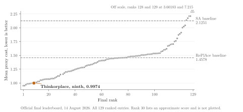

[Technical report (PDF)](thinkorplace-technical-report.pdf) ·
[Source code](https://github.com/brmurrell3/macro-placer) ·
[Placement explorer](placement-comparison.html)

Macro placement decides where to place large components on a chip before its
wires are routed. Each of these blocks, called a macro, is a pre-designed
circuit. Macros that have wires connecting them should sit nearby so the wires
stay short, but macros that are too close leave no room to route those wires.
Macros may not overlap.

Thinkorplace is the placer I designed and implemented for the Partcl/Hudson
River Trading Macro Placement Challenge 2026. It finished ninth of 132 verified
eligible submissions with a verified mean proxy of 0.9974, 31.6% better than the
published RePlAce baseline. It ran in 12 minutes per test case, out of 60
allowed.

<!-- The chart is drawn for a white background, so it keeps a white card in dark mode; the link opens it full size for small screens. -->

## How entries were scored

Entries were ranked on 17 IBM benchmark designs by the proxy cost from Google’s
Circuit Training, which combines wirelength, density and congestion. Lower is
better. The reference evaluator takes 1.4 to 27 seconds to score one placement,
far too slow to test moves one at a time.

## How Thinkorplace works

### v2

My first version took 53 minutes per design. v2, the ranked entry, replaced it
with two stages.

The first stage runs gradient descent on a smooth approximation of the score,
moving all the blocks together. A legalizer then removes overlaps by moving
macros into nearby free space, largest first.

The approximation is not the real score, so the second stage optimizes the real
score directly. Coordinate descent moves one block along one axis at a time and
keeps a move only if the exact score drops. Each block stays inside the free gap
around it, so the placement stays legal.

An incremental scorer makes this practical. Moving one block touches only a few
nets and grid cells, so the scorer updates just those. A move takes 1.3 to 3.7
milliseconds instead of 1.4 to 27 seconds, with the same score up to rounding.
That is about 100,000 moves in ten minutes instead of a few hundred.

### v3

v3 came after the competition. It keeps both stages and changes the start. It
draws many starting layouts, called seeds, by repeatedly splitting the blocks
into balanced halves, ranks them with a cheap score and sends only the best
through. Three chains run side by side, one per core. One starts from the
placement the benchmark supplies and two from drawn seeds. v3 keeps the best
placement any chain finds in 12 minutes.

## Results

v2 finished ninth with a verified mean proxy of 0.9974. Rerun on my laptop after
the competition, it scored 0.98121 with valid placements on all 17 designs.

With the same 12 minutes and three cores per design on my laptop, v3 scored
about 4% lower than v2, about 0.94 against 0.99, and was lower on 16 of the 17
designs. On four designs from a second benchmark family, NG45, that nothing was
tuned on, it was lower on all four and about 4% lower on average.

These are proxy scores, not results from a full place-and-route flow, and I
developed the method on the same 17 public designs used for the ranking.

## The math behind it

### Why the starting layout matters

A layout of ibm01 is one point in a space with two coordinates for each of its
1,140 blocks, and most of that space is illegal because macros may not overlap.
To see what lies between good answers, I mixed three finished layouts block by
block over a grid. Of 841 mixes, only the three answers themselves were legal.

The good answers sit on tiny islands. Moving any of them a hundred thousandth of
the way toward another already makes macros overlap. Local search that stays
legal cannot cross from one island to another, so the seed decides where a run
ends.

### Picking seeds with a cheap score

So v3 screens seeds with a cheap score instead of polishing all of them. The
span score adds up how far wires stretch across the die. Congestion averages the
fullest 5% of routing loads, so it can never fall below the mean load, and the
span score is a lower bound on the wire part of that mean.


\text{congestion} \;\ge\; \text{mean load} \;\gtrsim\; \text{span score}


A seed with a high span score starts with a high floor under its congestion, and
the span score costs far less than a descent.

### Why the exact search is needed

The exact score has steps that the smooth approximation cannot see. One macro of
ibm01 is about 1.2 grid cells wide, so one or two grid lines lie inside it. The
scorer charges blockage for each line, where the smooth approximation charges
one average.

### Why v3 beats v2

The chain that starts from the supplied placement holds about three quarters of
v3’s lead and returned v3’s final placement on 10 of the 17 designs. v2 also
starts from the supplied placement, so the start is not the whole story. From
the same seeds, v3’s later schedule ended 1% to 2% lower. v3 also keeps three
cores busy for all 12 minutes, while v2’s exact search runs on one thread and
used a sixth to a third of the core time it was offered.

### What did not help

An optimal reassignment can make the placement worse. The Hungarian method finds
the best assignment of blocks to slots for the costs it is given, but those
costs treat each move as if every other block stays put. When blocks
a and b share a net, the change
from moving both is not the sum of the changes from each.


\Delta(a, b) \ne \Delta(a) + \Delta(b)


In a two-block example, the costs predict a wirelength drop of 18, but making
both moves raises wirelength by 14.

### Making it faster

Rewriting the exact local search in Rust made one sweep 50 to 200 times faster.
On nine designs that version of v3 ended about 0.6% lower.

The first stage is gradient descent over a batch of layouts, so it suits a GPU.
In stock PyTorch each step is about a thousand small operations plus the
bookkeeping for automatic gradients. Those steps were rewritten as custom GPU
kernels that compute every gradient by hand, first in Metal on my laptop and then
in CUDA on a rented NVIDIA L4, and each is checked against a double-precision
version of the same math.

| Seconds for a 500-step descent | ibm01 | ibm07 | ibm17 |
|---|--:|--:|--:|
| NVIDIA L4, stock PyTorch | 14.5 | 32.1 | 58.8 |
| NVIDIA L4, CUDA kernels | 0.8 | 0.9 | 1.3 |
| Apple M3 Max, stock PyTorch | 21.3 | 36.0 | 55.7 |
| Apple M3 Max, Metal kernels | 1.2 | 1.3 | 1.4 |

That is 20 to 50 times faster on the L4 and 20 to 40 times on my laptop, with no
measurable change in where the descent ends. Most of the gain comes from fusing
work. A kernel step makes 26 GPU launches where stock PyTorch makes 500 to 750,
and it keeps the GPU busy for over 90% of the step. Rewriting the step with
plain PyTorch operations only got 3 to 4 times.

The kernels, with their correctness checks and a roofline of the L4, are in the
repository’s [kernels folder](https://github.com/brmurrell3/macro-placer/tree/main/kernels).
v3 is in the [submissions folder](https://github.com/brmurrell3/macro-placer/tree/main/submissions/thinkorplace-v3).
