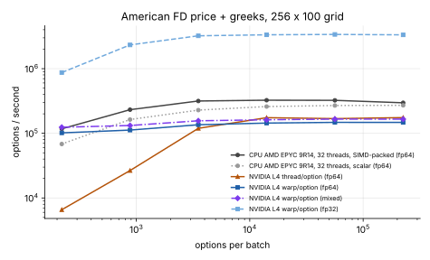

[Source code](https://github.com/brmurrell3/quant-lib) ·
[Full write-up](https://github.com/brmurrell3/quant-lib/blob/main/docs/writeup.md) ·
[Benchmark tables](https://github.com/brmurrell3/quant-lib/blob/main/docs/results.md)

I do my own volatility research on a Rust engine that replays option quotes,
fits implied volatility smiles and screens the surface for mispricings. That
engine is private. Its pricer is public: quant-lib is a C++17/CUDA library,
rebuilt from the engine's pricing code, that prices batches of options on CPUs
and NVIDIA GPUs and calibrates SABR and SSVI volatility surfaces.

On one NVIDIA L4 it prices 3.3 million American options a second in single
precision. That is 11 times a 32-core server CPU running the same grid in
double precision, and the single-precision error is smaller than the error the
pricing grid already makes. In double precision the L4 prices 175 thousand a
second and loses to that CPU. Every GPU result is checked against a
double-precision CPU reference, and the benchmarks include the cases where the
GPU loses.

<!-- The chart is drawn for a white background, so it keeps a white card in dark mode; the link opens it full size for small screens. -->

## Why price in batches

An American option has no closed-form price. Pricing one means solving a
partial differential equation on a grid, and turning a market price into an
implied volatility takes three to five of those solves.

The Rust pricer in my research engine takes 1.63 ms per American implied vol on
one cloud core. That is fine for one option. A cross-section of a few hundred
underlyings with 200 to 1,000 listed options each is 100 thousand to a million
options per refresh, which is 3 to 27 minutes of single-core time, before
multiplying by spot and vol shocks for scenario grids.

| Step | Machine | Time per implied vol |
|---|---|--:|
| Rust pricer, one thread | x86 cloud core | 1.63 ms |
| quant-lib CPU solver, one thread | same core | 0.45 to 0.53 ms |
| quant-lib CPU, 32 threads, SIMD | AMD EPYC 9R14 | 13.5 µs |
| quant-lib GPU, double precision | NVIDIA L4 | 26.5 µs |
| quant-lib GPU, single precision | NVIDIA L4 | 0.90 µs |

The single-thread gain is algorithmic: a better first guess for the implied
vol, and a tridiagonal solve with the early-exercise check folded into back
substitution. The multicore gain comes from packing eight options into the
lanes of one SIMD register. The GPU gain depends on precision, which is the
main finding.

## What quant-lib prices

Everything below runs on both the CPU and the GPU, on batches of options, in
single or double precision:

- Black-Scholes prices and Greeks, and European implied vol
- American and European prices by finite differences (Crank-Nicolson), with
  discrete cash dividends and borrow, plus delta, gamma and theta from the grid
- American implied vol
- Spot and vol scenario grids with a portfolio P&L reduction
- SABR calibration per expiry and SSVI calibration per surface, with every SSVI
  fit constrained to be free of static arbitrage

## Results

The GPU is an NVIDIA L4 on an AWS g6.xlarge. The CPU baseline is a 32-core AMD
EPYC 9R14 (c7a.8xlarge) using AVX-512. Timings are the median of repeated runs
after a warmup, and GPU times are kernel-only.

| 225k American options, 256 x 100 grid | Options per second | Max relative error |
|---|--:|--:|
| CPU, 1 thread | 8.0k | reference |
| CPU, 32 cores | 296k | 0 |
| L4, double precision | 175k | 1e-14 |
| L4, mixed precision | 166k | 1e-6 |
| L4, single precision | 3.33M | 5e-5 |

- **In double precision the L4 loses to 32 CPU cores by 1.7 to 2.4 times.** The
  kernels are not untuned. The L4 runs double-precision arithmetic at 1/64 of
  its single-precision rate, and the profiler shows the kernels at that limit.
- **In single precision the L4 is 11 times faster on pricing and 15 times
  faster on implied vol,** at about 1/20 of the cost per option.
- **Single precision is accurate enough here.** Its error is 5e-5 relative. Two
  valid American schemes on the same grid already differ by 3e-4.
- **For one option the CPU wins,** at 0.14 ms against about 1 ms including the
  kernel launch. The GPU only pays off for batches.

## Keeping the grid on the chip

Each option needs one tridiagonal solve per time step, on a grid of 128 to 512
nodes. Where that grid lives decides the throughput.

**One thread per option.** Each GPU thread runs the CPU solver against scratch
memory. Interleaving that memory so the 32 threads of a warp read neighbouring
addresses made it 1.9 times faster. Even so, the working set does not fit in
the L4's cache, so the kernel streams the whole grid through memory twice per
time step and sits at 86% of the card's peak memory bandwidth. That is its
ceiling.

**One warp per option.** Here the 32 threads of a warp share one option, and
each holds its slice of the grid in registers. Every thread eliminates its own
interior nodes, the 64 boundary values are solved across the warp in six rounds
of register exchanges (parallel cyclic reduction), and each thread fills its
interior back in. Memory traffic drops to 0.01% of peak, and the kernel is
limited by arithmetic instead.

Which one wins depends on the grid. With 128 nodes the thread-per-option kernel
is twice as fast, because the six exchange rounds cost the same at any size.
With 512 nodes the warp-per-option kernel wins. The library ships both.

## What the profiler says

Nsight Compute on the L4, pricing 56 thousand American options:

| Kernel | Memory bandwidth used | Limited by |
|---|--:|---|
| Thread per option, double precision | 87% | memory bandwidth |
| Warp per option, double precision | 0.01% | double-precision arithmetic, 88% busy |
| Warp per option, single precision | 0.1% | latency of the exchange rounds |

The thread-per-option kernel is at its roof, so more occupancy would not help.
Only moving fewer bytes per time step would. The warp-per-option kernel uses
224 registers per thread, which caps occupancy at 16%, and that is not what
limits it: the double-precision units stay saturated anyway. The
[full write-up](https://github.com/brmurrell3/quant-lib/blob/main/docs/writeup.md)
has the roofline for every kernel.

## Calibration

Each fit is a three-parameter Levenberg-Marquardt problem with exact Jacobians.

| Fits per second | SABR, 1M expiries | SSVI, 100k surfaces |
|---|--:|--:|
| CPU, 32 cores, double precision | 1.72M | 370k |
| L4, double precision | 965k | 379k |
| L4, single precision | 49.9M | 19.2M |

The obvious mapping, one GPU thread per fit, wastes most of each warp, because
fits finish after different numbers of iterations. Giving each fit a group of
threads that share its quotes keeps 28 of 32 threads busy on SSVI and makes it
2.8 times faster in double precision.

The first GPU run also found a bug in the fitter. Five of 3,000 SABR fits
disagreed with the CPU, all with the correlation parameter at its bound, where
the damping left one direction almost free. Flooring the damping fixed it: 630
of 100 thousand fits improved and none got worse.

## Accuracy

- The CPU reference is checked against textbook values, a binomial tree,
  second-order convergence in the grid and put-call parity: 3,848 checks.
- The GPU in double precision matches the CPU to 1e-14 relative.
- Single precision started with an absolute error of 0.14. Working in
  log-spot coordinates relative to spot, and removing a cancellation in the
  payoff, brought it to 5e-5 relative.
- American implied vols are checked by repricing, because vol error is
  unbounded for deep in-the-money puts where vega is near zero.

## The research engine

The engine these numbers started from is a private Rust workspace. Option
quotes flow into a parquet warehouse and can be replayed. Smiles, Greeks and
realized vol are computed on top, and screens scan the surface for
dislocations. It also has a backtester, DuckDB queries over the warehouse and
Python bindings for notebooks.

## Not done

- Double-precision results on a GPU with full-rate double precision, such as an
  A100 or H100. The conclusion above is specific to the L4.
- A library baseline for the hand-written solves (cuSPARSE batched tridiagonal).
- Working out why only 17 of 32 threads are active on average in the
  warp-per-option kernel.
