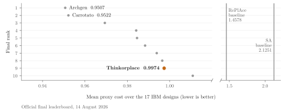

I designed and implemented Thinkorplace, a solver for chip macro placement:
deciding where a chip's few hundred large blocks, such as memories, sit so that
the wires joining them stay short without crowding the space those wires need.
It placed ninth on the final leaderboard of the Partcl/HRT Macro Placement
Challenge 2026 (verified mean proxy 0.9974; the organizers report 132 verified
eligible submissions).

- **Role:** lead and corresponding author. I designed and implemented the
  solver, the exact incremental scorer and the experiment pipeline, and wrote
  the technical report; Xiaofei Zhang and Andrew Murrell advised, reviewed and
  edited.
- **Result:** 31.6% lower cost than the published RePlAce baseline, an
  established academic placer, and within 4.9% of the winner, using a listed 12
  of the allowed 60 minutes per design.
- **Key engineering:** an exact scorer that recomputes only what a move
  changes, about 1,000–18,000× faster per move than rescoring from scratch with
  the reference evaluator, so a 10-minute search can try about 100,000
  candidate moves instead of at most a few hundred.
- **Approach:** gradient descent on a smooth approximation of the score moves
  every block at once; an exact search then keeps a move only if the official
  score falls.
- **Tools:** Python, PyTorch (CUDA and Apple-silicon GPUs), NumPy, SciPy.

[Technical report (PDF)](thinkorplace-technical-report.pdf) ·
[Source code](https://github.com/brmurrell3/macro-placer) ·
[Interactive placement explorer](placement-comparison.html)

<!-- The chart is drawn for a white background, so it keeps a white card in dark mode; the link opens it full size for small screens. -->

## Technical summary

Lower is better: the winner, Archgen, scored 0.9507 and the published RePlAce
baseline 1.4578. The ranked entry was most likely a single pipeline, listed at
12 minutes per design; the judged commit was not recorded, so I infer it from
that runtime and the 20 May resubmission date.

A chip layout starts with its macros: hundreds of large rectangular blocks,
such as memories, among thousands of small standard cells. Nets (groups of
pins that must be wired together) join pins on these blocks; shorter nets mean less delay and power.
Wirelength alone is not enough: pulling connected blocks together crowds the
area and the routing channels the wires share, so the proxy score adds density
and congestion penalties. Hard macros must not overlap; each design gets one
hour.

The solver combines three ideas. Make the exact score cheap: an incremental evaluator
recomputes only what a move touches, about 1,000–18,000× faster per sampled
move than full recomputation by the reference Python evaluator (Measurement),
and agreeing with it within a relative 3×10⁻¹⁵ on the sampled moves. Use a smooth model for coordinated moves: gradient descent on a
differentiable approximation moves hundreds of macros at once, and legalization
then removes overlaps. Accept only by the exact score: a final pass moves one
macro at a time, keeping only moves that lower the exact proxy.

Lessons:

- **The simpler, faster pipeline beat the elaborate one.** In May development
  records (Historical), an ancestor of the ranked pipeline took 524 s per design
  against 3,192 s for the multi-stage v1 pipeline, and scored lower on 16 of 17
  designs; lower congestion supplied 84.5% of the gain.
- **Curvature-guided moves helped, but the record cannot credit the
  curvature.** In May research runs (Historical), nudging a stalled placement
  along a negative-curvature direction of the smooth model and re-polishing
  lowered the score in 190 of 204 attempts, with nearly equal success along both
  directions and every step size tried. Random-direction and zero-step
  (polish-only) controls of equal cost are the next tests.
- **An optimal linear assignment can still worsen the real objective.**
  Hungarian reassignment prices each macro-to-slot move with the others held
  fixed, but moves interact: in a two-macro example, a predicted wirelength
  change of −18 is actually +14.

A post-competition rerun of the ranked configuration on a laptop CPU gave a
mean proxy of 0.98121, with all 17 placements valid (Reproduction); the official
0.9974 came from different hardware, so the two are not a matched comparison.
The results are proxy scores only, without full place-and-route, and the 17
public designs that set the ranking were also used in development.

[Read the technical report](thinkorplace-technical-report.pdf) ·
[View source](https://github.com/brmurrell3/macro-placer) ·
[Explore the placements](placement-comparison.html) ·
[Cite](https://github.com/brmurrell3/macro-placer/blob/main/CITATION.cff)
